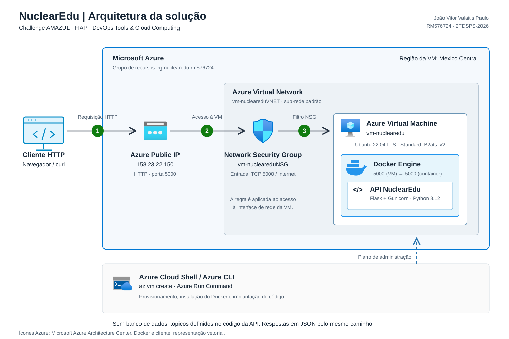

# NuclearEdu DevOps

**Aluno:** João Vitor Valaitis Paulo  
**RM:** 576724  
**Turma:** 2TDSPS-2026  
**Disciplina:** DevOps Tools & Cloud Computing — Sprint 1  
**Challenge:** AMAZUL

## Solução

API educativa sobre aplicações da tecnologia nuclear, desenvolvida com Flask e Gunicorn e executada em um container Docker em uma VM Ubuntu na Microsoft Azure. Não utiliza banco de dados.

## Arquitetura



O cliente acessa o IP público da VM pela porta TCP 5000, liberada no Network Security Group (NSG). O Docker encaminha a requisição para a API na porta 5000 do container.

## Execução

No Azure Cloud Shell, selecione Bash e execute:

```bash
git clone https://github.com/AganeSenpai/NuclearEdu-DevOps.git
cd NuclearEdu-DevOps
bash scripts/azure-criar.sh
bash scripts/azure-implantar.sh
bash scripts/azure-publicar.sh
```

O provisionamento usa Ubuntu 22.04 LTS, tamanho `Standard_B2ats_v2`, região `mexicocentral` e disco Standard HDD de 30 GB. Os comandos Azure CLI estão em [azure-criar.sh](scripts/azure-criar.sh). A implantação instala o Docker, constrói a imagem e inicia o container na VM usando Azure Run Command. Confirme `PUBLICAR` para liberar a porta 5000.

A construção e a execução realizadas pelo script na VM são:

```bash
docker build -t nuclearedu-api:1.0 .
docker run -d --name nuclearedu-api --restart unless-stopped -p 5000:5000 nuclearedu-api:1.0
```

## Teste

Obtenha o IP público e teste a API:

```bash
az vm show -d -g rg-nuclearedu-rm576724 -n vm-nuclearedu --query publicIps -o tsv
curl http://IP_PUBLICO:5000/health
curl http://IP_PUBLICO:5000/api/topicos
```

Substitua `IP_PUBLICO` pelo endereço retornado. A rota `/health` deve retornar `{"status":"ok"}`.

## Uso de Docker e Cloud Computing

Docker empacota a API e suas dependências em uma imagem reproduzível. Cloud Computing fornece a VM Ubuntu e os recursos de rede na Azure para executar o container e disponibilizar a aplicação pela internet.
